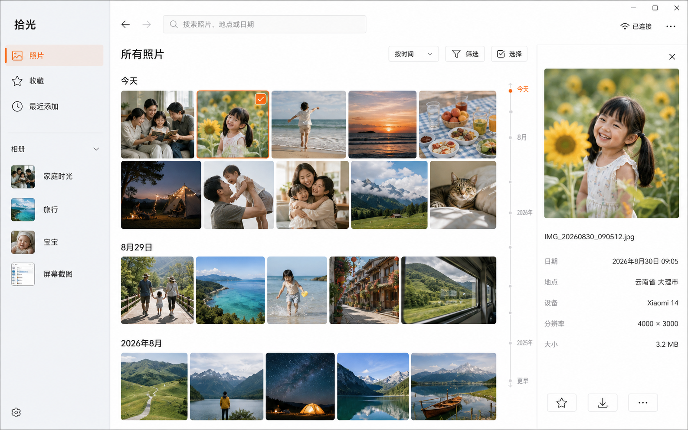

# Better Xiaomi Storage（拾光）

一个面向小米智能存储的开源、只读 Windows 相册。它为大型照片库提供时间轴、相册导航、年月日快速定位、搜索、媒体筛选、懒加载缩略图和大图预览。



## 主要功能

- 按拍摄日期浏览照片时间轴。
- 直接选择年、月、日，快速跳到很久以前的照片。
- 按相册、关键字和照片/视频类型筛选。
- 点击照片查看适应窗口的原图；点击视频使用原生播放器播放和拖动进度。
- 先读取轻量照片索引，再按需加载目标附近的缩略图，适合大型照片库。
- 只读访问，不提供删除、上传或修改设备内容的功能。

## 安装与使用

系统要求：Windows 10/11，以及已绑定小米账号的小米智能存储设备。

预发布版 `0.2.0-alpha.1` 接入独立登录：完整安装包携带所需的原生登录/P2P组件，无需另外安装官方客户端。已验证组件启动及模拟账号界面流程；真实账号登录、证书签发和设备读取仍待联调。正式版 `0.1.1` 仍使用官方客户端通道。

1. 从 [Releases](https://github.com/derekhe/better-xiaomi-storage/releases) 下载最新的 `better-xiaomi-storage-*-setup.exe`。
2. 运行安装程序。当前安装包未进行商业代码签名，Windows SmartScreen 可能显示“未知发布者”；请只从本仓库 Release 下载，并按下方方法核对 SHA-256。
3. 使用新的独立登录构建时，启动拾光，点击“登录小米账号”，在弹出的小米登录窗口中完成登录和验证。现有正式版仍需先打开并登录官方客户端。
4. 独立登录构建中选择要连接的存储设备，即可打开相册；之后可以按需建立完整的轻量时间索引。
5. 点击顶部的时间定位，依次选择年份、月份和日期，即可跳转到对应位置。

校验安装包（将文件名替换为实际版本）：

```powershell
Get-FileHash .\better-xiaomi-storage-0.1.0-setup.exe -Algorithm SHA256
Get-Content .\SHA256SUMS.txt
```

两处哈希值必须完全一致。

## 常见问题

- 独立登录时提示端口被占用：关闭正在运行的官方客户端，再在拾光中登录。原生组件使用固定的本机端口，两者不能同时运行。
- 独立登录后连接失败：确认设备在线、登录账号已绑定该设备，再重新选择设备。账号验证和设备证书仍由小米服务完成。
- 现有正式版提示“尚未找到设备证书”或“未找到设备通道”：保持官方客户端运行，进入一次官方相册后，在拾光中点击重连。
- 时间定位首次加载较慢：应用正在获取轻量索引，不会同时下载全部缩略图；之后定位只加载目标附近内容。
- SmartScreen 警告：0.1.0 尚未代码签名。请只使用 GitHub Release 中的文件并验证 SHA-256。

## 隐私与安全边界

- 应用只调用相册列表、照片列表和缩略图等读取接口，不上传、删除或修改设备文件。
- 独立登录使用随安装包附带的官方原生登录/P2P组件；拾光负责组件进程、设备选择、证书生命周期和读取通道。尚未重写原生 P2P 协议。
- 小米账号密码和登录验证在小米窗口中输入。应用不读取、复制官方客户端的 Cookie 或已有账号缓存。
- 拾光保存的登录会话及设备私钥使用 Electron `safeStorage` 的 Windows 凭据加密，证书和密钥只在主进程内用于 HTTPS；不会传给相册页面。
- 原生登录组件另有独立的浏览器/SDK缓存和日志。退出账号会清除本应用会话并尝试删除这些缓存；若 Windows 文件锁暂时阻止清理，下次登录会使用新的独立目录。原生组件的内部行为仍需进一步验证。
- 原图和视频通过拾光管理的本机 WebDAV 隧道按需读取；临时用户名和密码仅保存在 Electron 主进程内存中，不会传给页面。
- 连接探测只检查 `get_access_token` 的结果是否含令牌，令牌不保存或用于后续相册请求。
- 页面启用上下文隔离、禁用 Node 集成，并通过受限 IPC 接口访问本机设备通道。

本仓库不包含用户证书、私钥、令牌、设备 ID、照片或运行日志。原生组件位于被 Git 忽略的 `vendor` 目录。独立登录并不要求安装完整的官方客户端，但仍依赖这些原生组件。

## 开发

需要 Node.js 20 或更高版本。

```powershell
npm ci
npm run prepare:runtime
npm run dev
```

`prepare:runtime` 默认从本机官方客户端的安装目录导入组件，也可用 `npm run prepare:runtime -- --source <目录>` 指向官方安装包解压后的 `resources/extraResources/windows`。导入只允许程序、DLL、静态资源、SDK配置和公共 CA 链，不复制用户缓存、Cookie、日志或证书。组件包含独立的 SHA-256 清单，启动时检查完整性；完整安装包将携带组件，最终用户无需执行此步骤。

原生组件保留其原有许可，公开分发前应核实相关组件的分发条件。源码的 MIT 许可证不覆盖这些组件。

单独查看相册界面可运行 `npm run dev:web`，此时使用不含个人信息的样例数据。

```powershell
npm test
npm run build
npm run package
```

网页产物位于 `dist/renderer`，Windows 安装包位于 `release`；两者都不会提交到 Git。

维护者发布前应执行测试、构建、依赖与凭据扫描，并确认安装包中的 `app.asar` 只包含运行所需文件。

## 免责声明

这是非官方社区项目，与小米集团不存在隶属、授权或背书关系。“小米”及相关名称和商标归其各自权利人所有。使用前请自行评估风险并备份重要数据。

## 许可证

[MIT](LICENSE)
